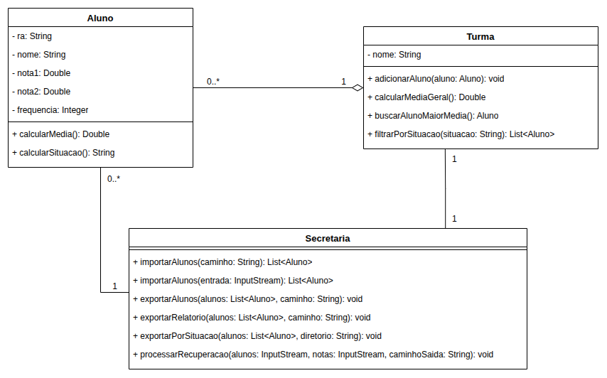

# Exercício - Importação e Exportação de CSV 📄

Importar e exportar arquivos **CSV** (*Comma-Separated Values*) é uma prática muito comum no mercado: é assim que sistemas trocam dados entre si e com planilhas como Excel e Google Sheets. Exemplos do dia a dia: importar a lista de clientes de outro sistema, exportar o extrato do banco, enviar a planilha de notas para a secretaria da faculdade, gerar relatórios para outra área da empresa.

Neste exercício você vai construir a `Secretaria` de uma faculdade, que **importa** as notas dos alunos de um CSV, aplica as regras de aprovação e **exporta** relatórios em CSV.

## Orientações Gerais 🚨

1. Utilize **apenas** tipos **wrapper** para criar atributos e métodos.
2. **Respeite** os nomes de atributos e métodos definidos no exercício.
3. Tome **cuidado** com os **argumentos** especificados no exercício.
4. **Não adicione** argumentos não solicitados e mantenha a ordem definida no enunciado.
5. Verifique se **não há erros de compilação** no projeto antes de enviar.
6. As classes devem seguir as regras de **encapsulamento**.
7. Você pode usar a API de arquivos que preferir: `Scanner`, `BufferedReader`/`BufferedWriter`, `FileWriter` ou `java.nio.file.Files`.

---

## Diagrama de classe


## Formato do arquivo CSV 📑

O arquivo `alunos.csv` (na raiz do projeto, ~500 linhas) contém as notas de uma turma:

```csv
ra;nome;nota1;nota2;frequencia
01250001;Pedro Oliveira;6.5;7.5;70
01250002;Juliana Cardoso;8.5;7.5;96

01250003;Henrique Barbosa;4.0;4.5;77
01259002;Nota Inválida;abc;7.0;90
```

- O separador é **ponto e vírgula** (`;`).
- A **primeira linha** é o cabeçalho e não representa um aluno.
- As notas usam **ponto** como separador decimal. A frequência é um número inteiro (porcentagem de 0 a 100).
- O arquivo **não é perfeito**: possui linhas em branco, linhas com colunas faltando/sobrando, valores que não são números e alunos com RA repetido. Seu código deve lidar com isso!

> 💡 Ao **exportar** números decimais, use sempre **2 casas e ponto** (ex.: `7.50`). Cuidado: `String.format("%.2f", valor)` usa o idioma do computador e pode gerar `7,50`. Use `String.format(Locale.US, "%.2f", valor)`.

---

## Classe: `Aluno` 🎓

- Atributos: `ra` (String), `nome` (String), `nota1` (Double), `nota2` (Double) e `frequencia` (Integer).
- Deve conter um construtor com **todos** os atributos, na ordem acima.
- Deve conter **todos** os métodos getters e setters.
- Deve conter o método `toString()`.

### Métodos Públicos

- `public Double calcularMedia()`
  - Retorna a média aritmética entre `nota1` e `nota2`.


- `public String calcularSituacao()`
  - Retorna a situação do aluno, seguindo as regras **nesta ordem**:
    1. Frequência menor que **75** → `"REPROVADO"` (independente da média).
    2. Média maior ou igual a **6** → `"APROVADO"`.
    3. Média maior ou igual a **4** → `"RECUPERACAO"`.
    4. Caso contrário → `"REPROVADO"`.

---

## Classe: `Turma` 🏫

- Atributos: `nome` (String) e `alunos` (List<Aluno>).
- A lista de alunos (`alunos`) deve ser **inicializada vazia** ao criar a turma, seja na declaração do atributo ou no construtor.
- Deve conter **todos** os métodos getters e setters.

### Métodos Públicos

- `public void adicionarAluno(Aluno aluno)`
  - Adiciona o aluno na turma. Não faz nada se o aluno for nulo, se o RA for nulo/vazio ou se já existir um aluno com o **mesmo RA** na turma.


- `public Double calcularMediaGeral()`
  - Retorna a média das médias de todos os alunos. Se a turma estiver vazia, retorna `0.0`.


- `public Aluno buscarAlunoMaiorMedia()`
  - Retorna o aluno com a **maior média**. Em caso de empate, retorna o primeiro encontrado. Se a turma estiver vazia, retorna `null`.


- `public List<Aluno> filtrarPorSituacao(String situacao)`
  - Retorna uma nova lista com os alunos na situação informada (`"APROVADO"`, `"RECUPERACAO"` ou `"REPROVADO"`), mantendo a ordem da turma.


---

## Classe: `Secretaria` 🗂️

### Métodos Públicos

- `public List<Aluno> importarAlunos(String caminho)`
  - Importa os alunos do arquivo CSV no caminho informado e retorna a lista de alunos.
  - Deve **pular o cabeçalho** e **ignorar linhas em branco**.
  - Deve **remover espaços extras** em volta de cada valor (ex.: `" Ana "` → `"Ana"`).
  - Deve **ignorar linhas inválidas**: quantidade de colunas diferente de 5, ou notas/frequência que não são números.
  - **Não** deve remover RAs repetidos (isso é responsabilidade da `Turma`).
  - Se o arquivo **não existir**, não deve lançar exceção: retorna uma **lista vazia**.


- `public List<Aluno> importarAlunos(InputStream entrada)`
  - **Sobrecarga** do método anterior: importa os alunos lendo de um `InputStream` em vez de um caminho, seguindo **as mesmas regras**.
  - Em sistemas reais, o CSV costuma chegar como `InputStream` (upload de arquivo, resposta de uma API, anexo de e-mail), e não como um caminho no disco.
  - Dica: depois de implementar este método, o `importarAlunos(String caminho)` pode apenas abrir o arquivo e reaproveitá-lo.


- `public void exportarAlunos(List<Aluno> alunos, String caminho)`
  - Exporta os alunos para o caminho informado, no **mesmo formato** do arquivo de importação.
  - A primeira linha deve ser o cabeçalho `ra;nome;nota1;nota2;frequencia`.
  - As notas devem ser gravadas com 2 casas decimais. Exemplo:
    ```csv
    ra;nome;nota1;nota2;frequencia
    001;Ana;8.00;9.00;90
    ```
  - Um arquivo exportado por este método deve poder ser importado novamente por `importarAlunos`.


- `public void exportarRelatorio(List<Aluno> alunos, String caminho)`
  - Exporta um relatório com a média e a situação de cada aluno, **na mesma ordem da lista recebida**.
  - Cabeçalho: `ra;nome;media;situacao`. A média deve ter 2 casas decimais. Exemplo:
    ```csv
    ra;nome;media;situacao
    001;Ana;8.50;APROVADO
    002;Bruno;4.50;RECUPERACAO
    003;Carla;10.00;REPROVADO
    ```
  - Dica: reutilize os métodos `calcularMedia()` e `calcularSituacao()` da classe `Aluno`.


- `public void exportarPorSituacao(List<Aluno> alunos, String diretorio)`
  - Exporta **três arquivos** dentro do diretório informado: `aprovados.csv`, `recuperacao.csv` e `reprovados.csv`.
  - Cada arquivo segue o mesmo formato do relatório (`ra;nome;media;situacao`), mantendo a ordem original dos alunos.
  - Se não houver alunos em uma situação, o arquivo deve ser criado **apenas com o cabeçalho**.

---

### Desafio ⚡

Depois da prova de recuperação, a coordenação enviou um segundo arquivo, `notas-recuperacao.csv`, com a nota da prova de cada aluno:

```csv
ra;notaRecuperacao
01250003;7.5
01250010;3.0
```

- `public void processarRecuperacao(InputStream alunos, InputStream notas, String caminhoSaida)`
  - Recebe o CSV de alunos e o CSV de notas de recuperação como `InputStream` (como se tivessem sido enviados por upload) e exporta o resultado para o arquivo `caminhoSaida`.
  - Dica: reaproveite o `importarAlunos(InputStream)` para importar os alunos.
  - O CSV de notas também pode ter cabeçalho, linhas em branco e linhas inválidas (quantidade de colunas diferente de 2 ou nota que não é número): ignore-as.
  - Se um RA aparecer **mais de uma vez** no CSV de alunos, considere apenas a **primeira** ocorrência (dica: a `Turma` já faz isso).
  - Considere **somente** os alunos em `"RECUPERACAO"`. Para cada um deles:
    - Procure a nota de recuperação pelo RA. Se o aluno **não tiver nota** no CSV de notas, considere a nota `0.0`. Se tiver mais de uma, use a **primeira**.
    - `mediaFinal = (media + notaRecuperacao) / 2`
    - Situação final: `"APROVADO"` se a média final for maior ou igual a **6**, senão `"REPROVADO"`.
  - Exporta o resultado para `caminhoSaida`, na ordem do CSV de alunos, com o cabeçalho `ra;nome;media;notaRecuperacao;mediaFinal;situacao` e números com 2 casas decimais:
    ```csv
    ra;nome;media;notaRecuperacao;mediaFinal;situacao
    002;Bruno;4.50;8.00;6.25;APROVADO
    007;Gabriela Simões;4.00;0.00;2.00;REPROVADO
    ```
  - Se não houver alunos em recuperação, exporta **apenas o cabeçalho**.

---

## Observações

- **Crie um método main dentro da classe Main** que importe o `alunos.csv`, adicione os alunos em uma `Turma`, mostre no console a quantidade de alunos, a média geral, o aluno com a maior média e a quantidade por situação, e exporte o `relatorio.csv`.
- Para testar o desafio no `Main`, abra o `alunos.csv` e o `notas-recuperacao.csv` (que estão na raiz do projeto) com `new FileInputStream(...)` e passe os streams para o método.
- Abra o `alunos.csv` e o `relatorio.csv` gerado para conferir se a importação descartou as linhas problemáticas.
