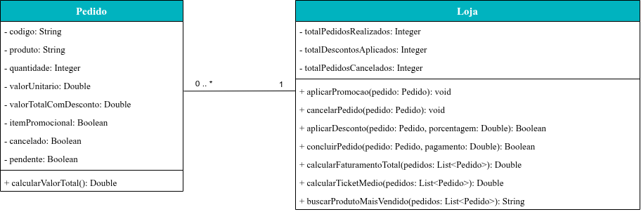
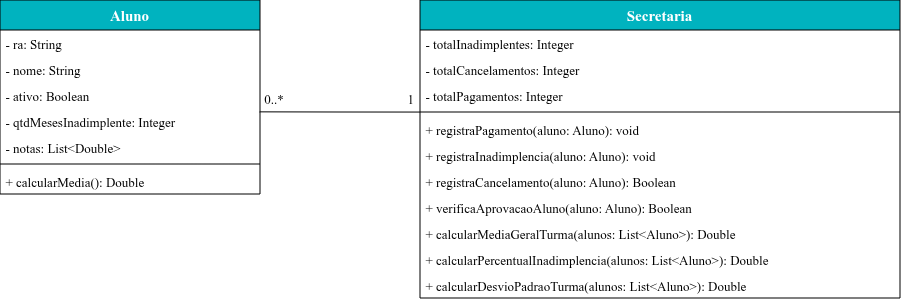

# Exercício Associação 🤝

## Orientações Gerais: 🚨
1. Utilize **apenas** tipos **wrapper** para criar atributos e métodos.
2. **Respeite** os nomes de atributos e métodos definidos no exercício.
3. Tome **cuidado** com os **argumentos** especificados no exercício.
   **Não** adicione argumentos não solicitados e mantenha a ordem definida no enunciado.
4. Verifique se **não** há **erros de compilação** no projeto antes de enviar.
5. As classes devem seguir as regras de encapsulamento.

## Exercício 01 – Sistema de Pedidos

Implemente as classes Pedido e Loja da seguinte forma:

## Pedido

* Deve possuir um construtor cheio.
* Deve possuir getters e setters.

Métodos:

* `calcularValorTotal()`
  * Deve calcular e retornar o valor total da compra: `valorUnitario * quantidade`.

## Loja

* Deve possuir um construtor vazio que inicializa os atributos como zero.
* Deve possuir somente getters.

Métodos:

* `aplicarPromocao(Pedido pedido)`
  * Atribui `true` para o atributo itemPromocional do pedido.

* `cancelarPedido(Pedido pedido)`
  * Atribui `true` para o atributo cancelado do pedido e incrementa totalPedidosCancelados.

* `aplicarDesconto(Pedido pedido, Double porcentagem)`
  * Aplica a porcentagem de desconto no valor total do pedido.
  * Caso o pedido esteja marcado como itemPromocional e não esteja cancelado, realize os cálculos, atualize o atributo
    valorTotalComDesconto do pedido, incremente totalDescontosAplicados e retorne `true`.
  * Caso contrário, não altere nenhum atributo e retorne `false`.

* `concluirPedido(Pedido pedido, Double pagamento)`
  * Confere se o pagamento não é nulo, zero ou negativo, além de conferir se o pedido não está cancelado e permanece
    pendente. Se qualquer uma dessas condições for falsa, retorne `false`.
  * Caso as condições acima sejam atendidas, confira se o pedido está marcado como itemPromocional:
    * Se for, confira se o pagamento cobre o valorTotalComDesconto do pedido. Caso cubra, atualize o atributo pendente
      do pedido para `false`, incremente totalPedidosRealizados e retorne `true`; caso contrário, retorne `false`.
    * Se não for, confira se o pagamento cobre o valor total do pedido. Caso cubra, atualize o atributo pendente do
      pedido para `false`, incremente totalPedidosRealizados e retorne `true`; caso contrário, retorne `false`.

* `calcularFaturamentoTotal(List<Pedido> pedidos)`
  * Deve calcular e retornar a soma do valor pago de todos os pedidos da lista recebida que não estão cancelados e não
    estão mais pendentes (ou seja, pedidos concluídos), considerando valorTotalComDesconto quando o pedido for
    itemPromocional, ou o valor total sem desconto caso contrário.
  * Caso não haja nenhum pedido concluído na lista, retorne 0.

* `calcularTicketMedio(List<Pedido> pedidos)`
  * Deve calcular e retornar o valor médio dos pedidos concluídos (não cancelados e não pendentes) da lista recebida,
    dividindo o faturamento desses pedidos pela quantidade deles.
  * Caso não haja nenhum pedido concluído na lista, retorne 0.

* 🏆 Desafio: `buscarProdutoMaisVendido(List<Pedido> pedidos)`
  * Deve retornar o nome do produto com a maior quantidade total vendida somando a quantidade de todos os pedidos
    concluídos (não cancelados e não pendentes) que possuem o mesmo produto (ignorando diferenças entre letras maiúsculas
    e minúsculas).
  * Em caso de empate, retorne o produto que aparece primeiro na lista.
  * Caso a lista esteja vazia ou não haja nenhum pedido concluído, retorne `null`.

## Exercício 02 – Sistema Acadêmico

Implemente as classes Aluno e Secretaria da seguinte forma:

## Aluno

* Deve possuir um construtor cheio.
* Deve possuir getters e setters.

Métodos:

* `calcularMedia()`
  * Deve calcular e retornar a média do aluno baseada em todas as suas notas.
  * Caso a lista de notas esteja vazia, retorne 0.

## Secretaria

* Deve possuir um construtor vazio que inicializa os atributos como zero.
* Deve possuir somente getters.

Métodos:

* `registraPagamento(Aluno aluno)`
  * Zera o atributo qtdMesesInadimplente e incrementa totalPagamentos.

* `registraInadimplencia(Aluno aluno)`
  * Soma um mês ao atributo qtdMesesInadimplente do aluno e incrementa totalInadimplentes.

* `registraCancelamento(Aluno aluno)`
  * Caso a qtdMesesInadimplente seja pelo menos 3, atribua `false` para o atributo ativo do aluno, incremente totalCancelamentos e retorne `true`.
  * Caso contrário, retorne `false`.

* `verificaAprovacaoAluno(Aluno aluno)`
  * Valida todas as informações do aluno, inclusive se está ativo, inadimplente e se foi aprovado ou reprovado, considerando que a média mínima para aprovação é 6.
  * Caso o aluno esteja ativo, não seja inadimplente (ou seja, caso não possua nenhum mês de inadimplência) e tenha sido aprovado, retorne `true`.
  * Caso contrário, retorne `false`.

* `calcularMediaGeralTurma(List<Aluno> alunos)`
  * Deve calcular e retornar a média das médias de todos os alunos ativos da lista recebida, somando a média de cada 
  aluno ativo e dividindo pela quantidade de alunos ativos.
  * Caso não haja nenhum aluno ativo na lista, retorne 0.

* `calcularPercentualInadimplencia(List<Aluno> alunos)`
  * Deve calcular e retornar o percentual de alunos inadimplentes em relação ao total de alunos da lista recebida.
  * Caso a lista esteja vazia, retorne 0.

* 🏆 Desafio: `calcularDesvioPadraoTurma(List<Aluno> alunos)`
  * Deve calcular e retornar o desvio padrão das médias dos alunos ativos da lista recebida, seguindo os passos:
    1. Calcule a média da turma.
    2. Para cada aluno ativo da lista, calcule o quadrado da distância entre a média dele e a média da turma:
       1. Calcule a média do aluno atual.
       2. Calcule a diferença entre a média do aluno e a média da turma: `diferenca = mediaAluno - mediaTurma`.
       3. Eleve essa diferença ao quadrado: `diferenca²`.
       4. Some o resultado a um acumulador (somaDosQuadrados), que deve começar em 0 antes do laço.
    3. Calcule a variância, dividindo somaDosQuadrados pela quantidade de alunos ativos: `variancia = somaDosQuadrados 
    / quantidadeDeAlunosAtivos`.
    4. Calcule o desvio padrão, tirando a raiz quadrada da variância: `desvioPadrao = √variancia`.
  * **Dica**: utilize `Math.pow(base, 2)` (ou multiplique o valor por ele mesmo) para elevar ao quadrado, e 
  `Math.sqrt(valor)` para calcular a raiz quadrada. Lembre-se também que já existe um método para calcular a média do
  aluno e outro que calcula a média de toda a turma, utilize-os nesse método para facilitar os cálculos.
  * Caso não haja nenhum aluno ativo na lista, retorne 0.
