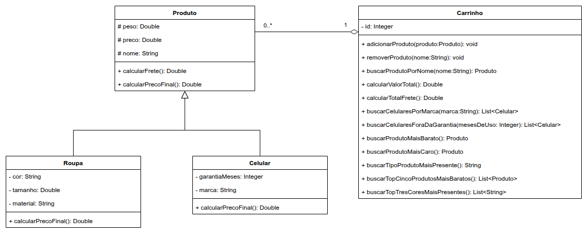

# Exercício - Carrinho de Compras 🛒

## Orientações Gerais 🚨

1. Utilize **apenas** tipos **wrapper** para criar atributos e métodos.
2. **Respeite** os nomes de atributos e métodos definidos no exercício.
3. Tome **cuidado** com os **argumentos** especificados no exercício.
4. **Não adicione** argumentos não solicitados e mantenha a ordem definida no enunciado.
5. Verifique se **não há erros de compilação** no projeto antes de enviar.
6. As classes devem seguir as regras de **encapsulamento**.

---

## Diagrama de classe

## Classe: `Produto` 🪴

- Deve conter **todos** os métodos getters e setters para os atributos `preco`, `nome` e `peso`.
- Deve conter o método `toString()`.

### Métodos Públicos

- `public Double calcularFrete()`
  - Retorna o valor do frete do produto, que é R$2,00 por kg (considere que kg é a medida usada no atributo `peso`).

- `public Double calcularPrecoFinal()`
  - Retorna o preço final do produto, que é o preço do produto com frete aplicado.

## Classe: `Roupa` 👚

- Deve conter **todos** os métodos getters e setters para os atributos `tamanho`, `cor` e `material`.
- Deve conter o método `toString()`.

### Métodos Públicos

- `public Double calcularPrecoFinal()`
  - Calcula o preço final da roupa, aplicando um desconto de 15% para roupas de material "**couro**" (ignorando 
  maiúsculas ou minúsculas) ao preço final.

## Classe: `Celular` 📱

- Deve conter **todos** os métodos getters e setters para os atributos `garantiaMeses` e `marca`.
- Deve conter o método `toString()`.

### Métodos Públicos

- `public Double calcularPrecoFinal()`
  - Calcula o preço final do celular, somando 50 reais para cada mês de garantia ao preço final.

---

## Classe: `Carrinho` 🛒

- Deve conter **todos** os métodos getters e setters para os atributos da classe.

### Métodos Públicos

- `public void adicionarProduto(Produto produto)`
  - Adiciona um produto válido ao carrinho. Caso o produto seja inválido (preço nulo, igual ou menor que zero, nome 
  nulo ou com espaços vazios, peso nulo, igual ou menor que zero), não faz nada.

- `public void removerProduto(String nome)`
  - Remove todos os produtos encontrados do carrinho pesquisando por um nome (ignorando maiúsculas ou minúsculas). 
  Caso o produto não esteja presente, não faz nada.
  - Certifique-se de remover mesmo com dois produtos com mesmo nome na sequência. (Utilize o main para testar)

- `public Produto buscarProdutoPorNome(String nome)`
  - Retorna o primeiro produto com o nome especificado (ignorando maiúsculas ou minúsculas). Se o produto não for 
  encontrado, retorna `null`.

- `public Double calcularValorTotal()`
  - Calcula o valor total de todos os produtos no carrinho. Retorna a soma do preço finais de todos os produtos. Caso 
  não haja nenhum produto na lista, retorna **0.0**.

- `public Double calcularTotalFrete()`
  - Calcula o valor total de frete de todos os produtos no carrinho. Retorna a soma do frete incluso em todos os 
  produtos. Caso não haja nenhum produto na lista, retorna **0.0**.

- `public List<Celular> buscarCelularesPorMarca(String marca)`
  - Retorna uma lista de celulares do carrinho com a marca especificada (ignorando maiúsculas ou minúsculas). Filtra os 
  produtos do tipo `Celular` e compara a marca do celular com a marca passada como parâmetro, caso a lista de produtos 
  esteja vazia ou não haja nenhum celular de determinada marca, retorna uma lista vazia.

- `public List<Celular> buscarCelularesForaDaGarantia(Integer mesesDeUso)`
  - Retorna os celulares do carrinho que estão fora da garantia, onde o tempo de uso é maior que a garantia. Caso a
  lista de produtos esteja vazia ou não possua nenhum celular fora da garantia, retorna uma lista vazia. 

- `public Produto buscarProdutoMaisBarato()`
  - Retorna o produto mais barato do carrinho (considere o preço final). Caso o carrinho esteja vazio, retorna `null`.

- `public Produto buscarProdutoMaisCaro()`
  - Retorna o produto mais caro do carrinho (considere o preço final). Caso o carrinho esteja vazio, retorna `null`.

---

### Desafio ⚡

- `public String buscarTipoProdutoMaisPresente()`
  - Retorna o tipo do produto ("**normal**", "**roupa**" ou "**celular**") que mais se repete no carrinho. Caso o 
  carrinho esteja vazio retorne `null` e em caso de empate, retorne o tipo que aparece primeiro na lista.

- `public List<Produto> buscarTopCincoProdutosMaisBaratos()`
  - Retorna os 5 produtos mais baratos do carrinho, ordenados de acordo com o preço final. Caso o carrinho esteja vazio, 
  retorne `null`, em caso de empate, matenha na ordem de aparição na lista e caso o carrinho tenha menos de 5 itens, 
  retorne a lista ordenada pelo mais barato da mesma forma.
  - **Restrição**: Não é permitido usar métodos ou estruturas prontas de ordenação do Java, como Collections.sort, 
  List.sort, Arrays.sort, stream().sorted(), Comparator, Comparable etc. A ordenação e a seleção dos elementos devem 
  ser implementadas manualmente (por exemplo, com laços e comparações).

---

## Observações

- **Crie um método main dentro da classe Main para testar o funcionamento dos métodos**
