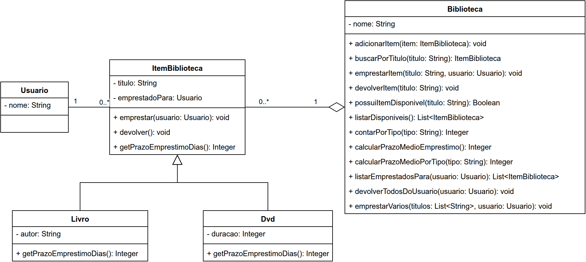

# Exercício - Herança com Exceptions 📚

## Orientações Gerais 🚨

1. Utilize **apenas** tipos **wrapper** para criar atributos e métodos.
2. **Respeite** os nomes de atributos, classes e métodos definidos no exercício.
3. Tome **cuidado** com os **argumentos** e tipos exigidos no enunciado.
4. **Não adicione** argumentos não solicitados e mantenha a assinatura definida.
5. Verifique se **não há erros de compilação** no projeto antes de enviar.
6. As classes devem seguir as regras de **encapsulamento**.

---

## Objetivo 🎯

Implementar um sistema simples de biblioteca para praticar:

- **Herança**
- **Sobrescrita de método** (`@Override`)
- **Exceptions checked e unchecked**
- **Tratamento com `try/catch` e propagação com `throws`**

---

## Diagrama de classe

## Exceptions do Sistema ⚠️

### `DadoInvalidoException` (unchecked)

- Deve ser usada para entradas inválidas (nulas, em branco, valores não permitidos).

### `ItemNaoEncontradoException` (unchecked)

- Deve ser usada quando um item não for encontrado em busca/devolução.

### `ItemIndisponivelException` (checked)

- Deve ser usada quando tentarem emprestar um item já indisponível.

---

## Classe: `Usuario` 🙋

### Construtor

**`Usuario(String nome)`**

- Deve lançar `DadoInvalidoException` se `nome` for `null` ou em branco.

### Métodos Públicos

**Deve conter todos os Getters e Setters**

---

## Classe: `ItemBiblioteca` 📦

### Construtor

**`ItemBiblioteca(String titulo)`**

- Deve lançar `DadoInvalidoException` se `titulo` for `null` ou em branco.

### Métodos

**`void emprestar(Usuario usuario)`**

- se usuario for `null`, deve lançar `DadoInvalidoException`.
- Se o item não estiver disponível, ou seja, já emprestado para outro usuário, deve lançar `ItemIndisponivelException`.
- Caso contrário, marca o item como indisponível e registra o usuário que pegou emprestado.

**`void devolver()`**

- Marca o item como disponível, ou seja, emprestadoPara deve ser `null`.

**`Integer getPrazoEmprestimoDias()`**

- Retorna o prazo padrão de empréstimo: **7** dias.

**Deve conter todos os Getters e Setters**

---

## Classe: `Livro` 📖

### Construtor

**`Livro(String titulo, String autor)`**

- Deve lançar `DadoInvalidoException` se `autor` for `null` ou em branco.
- Deve inicializar o atributo titulo corretamente.

### Métodos

**`Integer getPrazoEmprestimoDias()`**

- Deve retornar **14** dias.

**Deve conter todos os Getters e Setters**

---

## Classe: `DVD` 💿

### Construtor

**`DVD(String titulo, Integer duracao)`**

- Deve lançar `DadoInvalidoException` se `duracao` for `null` ou menor/igual a zero.
- Deve inicializar o atributo titulo corretamente.

### Métodos Públicos

**`Integer getPrazoEmprestimoDias()`**

- Deve retornar **3** dias.

**Deve conter todos os Getters e Setters**

---

## Classe: `Biblioteca` 🏫

### Construtor

**`Biblioteca(String nome)`**

- Deve lançar `DadoInvalidoException` se `nome` for `null` ou em branco.
- Deve inicializar a lista de itens.

### Métodos Públicos

**`void adicionarItem(ItemBiblioteca item)`**

- Deve lançar `DadoInvalidoException` se `item` for `null`.
- Caso válido, adiciona na lista da biblioteca.

**`ItemBiblioteca buscarPorTitulo(String titulo)`**

- Busca item pelo título (ignorando maiúsculas/minúsculas).
- Se não encontrar, deve lançar `ItemNaoEncontradoException`.

**`void emprestarItem(String titulo, Usuario usuario)`**

- Deve lançar `DadoInvalidoException` se `titulo` ou `usuario` for `null`.
- Deve buscar o item pelo título. Se não encontrar, deve lançar `ItemNaoEncontradoException`.
- Se o item for encontrado, deve chamar o método `emprestar` do item. 
- Caso o item esteja indisponível, não deve lançar `ItemIndisponivelException`, mas sim, exibir a mensagem: "Esse item já está emprestado para outro usuário."

**`void devolverItem(String titulo)`**

- Deve lançar `DadoInvalidoException` se `titulo` for `null`.
- Deve buscar o item pelo título. Se não encontrar, deve lançar `ItemNaoEncontradoException`.
- Se o item for encontrado, deve chamar o método `devolver` do item.

**`Boolean possuiItemDisponivel(String titulo)`**

- Deve lançar `DadoInvalidoException` se `titulo` for `null` ou em branco.
- Deve buscar o item pelo título. Se não encontrar, deve lançar `ItemNaoEncontradoException`.
- Se o item for encontrado, retorna `true` caso esteja disponível e `false` caso esteja emprestado.

**`List<ItemBiblioteca> listarDisponiveis()`**

- Retorna uma **nova** lista com os itens disponíveis, ou seja, que não estão emprestados (`emprestadoPara` igual a
  `null`), mantendo a ordem de cadastro.
- Se não houver itens disponíveis, retorna uma lista vazia.

**`Integer contarPorTipo(String tipo)`**

- Deve lançar `DadoInvalidoException` se `tipo` for `null`, em branco ou diferente dos valores permitidos.
- Os valores permitidos para `tipo` são `"DVD"` ou `"Livro"`, ignorando maiúsculas/minúsculas.
- Retorna a quantidade de itens do tipo informado, independentemente de estarem disponíveis ou emprestados.
- Se não houver itens do tipo informado, retorna `0`.

**`Integer calcularPrazoMedioEmprestimo()`**

- Se não houver itens cadastrados, retorna `0`.
- Caso contrário, retorna a média dos prazos de empréstimo dos itens.

**`Integer calcularPrazoMedioPorTipo(String tipo)`**

- Deve lançar `DadoInvalidoException` se `tipo` for `null`, em branco ou diferente dos valores permitidos.
- Os valores permitidos para `tipo` são `"DVD"` ou `"Livro"`, ignorando maiúsculas/minúsculas.
- Considera **apenas** os itens do tipo informado.
- Se não houver itens cadastrados do tipo informado, retorna `0`.
- Caso contrário, retorna a média dos prazos de empréstimo dos itens do tipo informado.

**`List<ItemBiblioteca> listarEmprestadosPara(Usuario usuario)`**

- Deve lançar `DadoInvalidoException` se `usuario` for `null`.
- Retorna uma **nova** lista com os itens que estão emprestados para o usuário informado, mantendo a ordem de cadastro.
- Para saber se o item está emprestado para o mesmo usuário, deve **comparar o atributo `nome`** do `Usuario` (e não a 
referência do objeto).
- Se o usuário não tiver nenhum item emprestado, retorna uma lista vazia.

**`void devolverTodosDoUsuario(Usuario usuario)`**

- Deve lançar `DadoInvalidoException` se `usuario` for `null`.
- Deve chamar o método `devolver` de **todos** os itens que estão emprestados para o usuário informado.
- Para saber se o item está emprestado para o mesmo usuário, deve **comparar o atributo `nome`** do `Usuario` (e não a 
referência do objeto).
- Itens disponíveis ou emprestados para outros usuários **não** podem ser alterados.
- Se o usuário não tiver nenhum item emprestado, não faz nada e não lança exceção.

---

### Desafio ⚡

**`void emprestarVarios(List<String> titulos, Usuario usuario)`**

- Deve lançar `DadoInvalidoException` se:
  - `titulos` ou `usuario` for `null`, ou se `titulos` estiver vazia.
  - **qualquer** título dentro de `titulos` for `null` ou em branco.
  - `titulos` contiver títulos **duplicados**, ignorando maiúsculas/minúsculas.
- Todas as validações de `DadoInvalidoException` devem ocorrer **antes** de qualquer busca ou empréstimo, ou seja, 
nenhum item pode ser emprestado caso algum desses dados seja inválido.
- Deve buscar cada item pelo título. Se **qualquer** título não for encontrado, deve lançar `ItemNaoEncontradoException` 
e **nenhum** item pode ser emprestado.
- O empréstimo é **tudo ou nada**: se **algum** dos itens já estiver emprestado, **nenhum** item do lote pode ser 
emprestado.
- Nesse caso, não deve lançar `ItemIndisponivelException`, mas sim, exibir a mensagem: "Não foi possível emprestar o 
lote: o item '<titulo>' está indisponível.", onde `<titulo>` é o título do **primeiro** item indisponível, seguindo a 
ordem da lista `titulos`.
- Se todos os itens estiverem disponíveis, deve chamar o método `emprestar` de cada um deles com o `usuario`.

---

**Deve conter todos os Getters e Setters**
